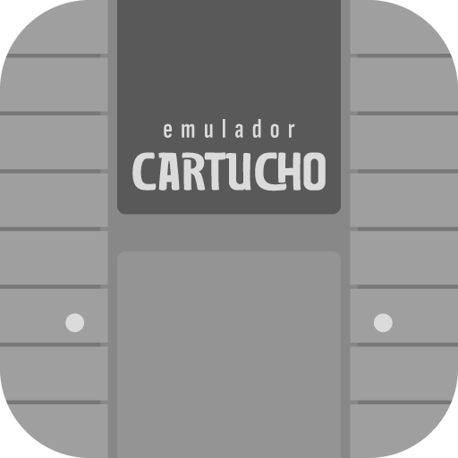

# Cartucho



Emulador minimalista para **Android e Windows**, do Atari 2600 ao PlayStation 2. Joga 100% offline. A internet só é usada para capas (pode desligar), hacks que você baixar, **RetroAchievements** e **backup de saves no Google Drive**.

> O Cartucho não inclui jogos nem BIOS e não indica onde obtê-los. Use apenas arquivos que você possui.

## Sistemas

Atari 2600 · Atari 7800 · Lynx · NES · SNES · Game Boy / Color · GBA · Master System · Game Gear · Mega Drive · Sega CD · 32X · PC Engine / CD · Neo Geo Pocket · WonderSwan · Arcade (FinalBurn Neo) · Nintendo 64 · Nintendo DS · Nintendo 3DS (novidade, experimental) · PlayStation · PSP · Saturn · Dreamcast · PlayStation 2

**Novos:** GameCube · Wii · Wii U (beta) · Xbox 360 (beta) · 3DO · Atari Jaguar · Atari 5200 · Atari 800/XL · Vectrex · Virtual Boy · Neo Geo CD · PC-FX · ColecoVision · Intellivision · Odyssey² · Channel F · MSX · ZX Spectrum · Amstrad CPC · Commodore 64 · Amiga · DOS · Pokémon Mini · Watara Supervision · Arduboy · Game & Watch

**No Windows, o Cartucho avisa antes de cada jogo** se ele deve rodar liso, engasgar, travar ou não rodar no seu computador (aba *Ajustes > Este computador*). Depois que você joga, o aviso passa a usar a velocidade medida de verdade.

Os emuladores (cores libretro) vão dentro do APK.

**Capas para todos os jogos:** o app busca a capa no acervo aberto [libretro-thumbnails](https://github.com/libretro-thumbnails) e, se não achar, na Wikipédia. Se ainda assim não existir capa (hacks, jogos raros), ele gera uma capa com o nome do jogo e continua procurando a oficial de tempos em tempos. Segure o jogo > *Trocar capa* para usar uma imagem sua.

**Versões do mesmo jogo:** regiões, revisões e traduções do mesmo jogo aparecem como um só cartão; ao tocar, você escolhe a versão.

**Hacks e traduções:** segure um jogo na biblioteca > *Hacks e traduções*. Aceita patches .ips, .ups e .bps (soltos ou dentro de .zip/.7z/.rar), por arquivo ou por link. O jogo original nunca é alterado. Em **Ajustes > Sistemas neste aparelho** o app diz, com honestidade, o que roda bem, o que pode engasgar e o que não é suportado no seu celular.

**Controles do seu jeito:** em *Ajustes > Controles* escolha joystick ou tela, mapeie cada botão do controle (um por um ou todos em sequência) e, no jogo, use *Menu > Controles* para mapear o joystick conectado sem sair da partida ou *Editar botões na tela* para arrastar e redimensionar os botões (salvo separado para retrato e paisagem).

**Na TV:** no menu do jogo, *Transmitir para TV* tem três modos: só celular, duplicar e só TV (o celular vira o controle). Conecte pelo espelhamento do Android (Smart View, Google Home) ou por cabo HDMI.

**Jogar com amigos:** no menu do jogo, *Jogar com amigos* já abre uma sala e mostra um QR.
- Quem tem o Cartucho lê o QR (pela câmera ou em *Entrar numa sala > Ler QR code*) e entra direto na sala.
- Quem não tem o app lê o mesmo QR e o navegador vira o controle, no mesmo Wi-Fi (ou no roteador do seu celular). Sem instalar nada.
- Para quem está longe: convide pelo WhatsApp ou pelo código. Funciona quando ao menos um dos dois está num Wi-Fi (ou no roteador do celular de quem criou a sala); com os dois nos dados móveis as operadoras bloqueiam a conexão direta. Quem entra assiste ao jogo em tempo real e vira o jogador 1 a 4. O jogo roda só no celular de quem criou a sala.

**Mural dos amigos:** em *Coleção > Mural*, veja o que você e quem você segue no RetroAchievements estão jogando, zeraram ou platinaram. Curta, reaja com emojis (❤️ 🔥 👏 😂 😮 🏆) e comente. O app avisa quando alguém interage com você e mostra os recados do seu perfil do RetroAchievements.

**Traduções PT-BR em um toque:** ao abrir um jogo que tem tradução da comunidade brasileira, o app pergunta se você quer aplicar (catálogo do [PO.B.R.E](https://romhackers.org/traducoes), com o crédito de cada equipe). Aceita IPS, UPS, BPS, PPF e xdelta, inclusive em jogos de PS1 e PS2 (.iso ou .bin/.cue).

**Loja de jogos grátis:** no topo da biblioteca, o ícone da sacola abre a Loja: mais de mil jogos e demos homebrew de Game Boy, Game Boy Color, GBA e NES, feitos por fãs e estúdios independentes e publicados pelos próprios autores no [Homebrew Hub](https://hh.gbdev.io). Busque, toque em *Baixar e jogar* e o jogo entra na biblioteca com capa, crédito e licença. Nenhum jogo comercial é oferecido.

**Card para compartilhar:** em qualquer jogo (segure o jogo, na Coleção ou no menu durante a partida) gere um card no formato do celular com a capa, o status (jogando, zerado, platinado), suas estrelas e as horas jogadas, e mande para WhatsApp, Instagram ou onde quiser.

**Coleção:** o diário dos seus jogos — status (jogando, zerado, platinado, abandonado), nota de 0,5 a 5 estrelas, resenha, horas jogadas contadas automaticamente e um cartão para compartilhar. Com a sua *Web API Key* do RetroAchievements, aparecem as platinas e o ranking com quem você segue.

## Versão para computador (Windows)

Em **Releases**, baixe `Cartucho-…-windows-instalador.exe` (ou o `.zip` para usar sem instalar). Windows 10/11 de 64 bits.

- **Adicionar pasta** e pronto: jogos soltos ou em `.zip` são encontrados sozinhos.
- **Teclado:** setas, Z (B), X (A), A (Y), S (X), Q/W (L/R), E/R (L2/R2), Enter (Start), Backspace (Select). Tudo trocável em *Ajustes > Controles*.
- **Joystick:** qualquer controle USB ou Bluetooth (Xbox, PlayStation, genéricos), até 4 jogadores, sem configurar.
- No jogo: **Esc** menu · **F2/F4** salvar/carregar estado · **F11** tela cheia · **Tab** acelerar.
- O Windows SmartScreen pode avisar na primeira vez (app sem certificado pago): clique em *Mais informações > Executar assim mesmo*.

## Como o APK é gerado

Tudo é compilado pelo **GitHub Actions** (gratuito), a cada envio para a branch `main`:

1. `scripts/fetch-deps.sh` baixa o `libretro.h`, o `rcheevos` e os cores oficiais do buildbot do libretro.
2. O Gradle compila o app e assina com a sua chave.
3. Os APKs saem em **Releases**, com o arquivo `SHA256SUMS.txt` para conferir a integridade.

### Chave de assinatura (uma vez só)

No repositório: **Settings > Secrets and variables > Actions > New repository secret**, crie:

| Nome | Valor |
|---|---|
| `CARTUCHO_KEYSTORE_PASSWORD` | a senha da chave |
| `CARTUCHO_KEYSTORE_B64` | o conteúdo de `keystore_base64.txt` |

Guarde o `cartucho.jks` em lugar seguro. Sem ele não é possível publicar atualizações que instalem por cima.

## Qual APK baixar

- `arm64-v8a` — quase todos os celulares atuais.
- `armeabi-v7a` — celulares antigos de 32 bits (sem PS2, Dreamcast e outros pesados).
- `x86_64` — Chromebooks e emuladores de PC.
- `universal` — funciona em qualquer um, mas é bem maior.

## Instalar no celular (sideload seguro)

1. No celular, abra o GitHub no navegador, entre na sua conta, vá em **Releases** e baixe o APK `arm64-v8a`.
2. Confira o SHA-256 (opcional): compare com o `SHA256SUMS.txt`.
3. Abra o arquivo baixado. O Android vai pedir para **permitir instalar apps desta fonte** só para o navegador ou gerenciador de arquivos que você usou. Permita, instale e depois desative essa permissão de novo.
4. O Play Protect pode avisar que o app é desconhecido: é normal para apps fora da Play Store. Toque em **Instalar mesmo assim**.

## Google Drive (opcional)

**Ajustes > Nuvem > Backup no Google Drive**: escolha a conta e pronto. O backup liga na hora e os saves vão para *Meu Drive / Cartucho*.

O app usa o escopo `drive.file`: ele só enxerga as pastas e arquivos que ele mesmo criou no seu Drive.

Para quem compila a própria versão: o login Google exige um ID do cliente OAuth do tipo **Android** no Google Cloud (pacote `app.cartucho` + SHA-1 da sua chave de assinatura) e a **Google Drive API** ativada no mesmo projeto.

## Privacidade e segurança

- Permissões: Internet e estado da rede (RA, Drive, salas e mural), vibração e avisos (opcional, para o mural). Nenhum acesso amplo a arquivos: os jogos são abertos pelo seletor do Android.
- Sem anúncios, analytics, telemetria ou crash reporting remoto.
- Token do RetroAchievements cifrado no Android Keystore; a senha nunca é guardada.
- HTTPS obrigatório; APK assinado com esquemas v1, v2 e v3; R8 ativado.

## Limitações conhecidas

- PS2 (core Play!) ainda é exigente no Android: nem todo jogo roda bem.
- Nintendo DS e 3DS: em pé, as duas telas ficam em cima e os controles embaixo; toque com o dedo na tela de baixo (no PC, clique com o mouse).
- Nintendo 3DS: exige celular 64-bit potente; os jogos precisam estar descriptografados (.3ds/.cci/.cxi/.3dsx). Não roda em celulares 32-bit.
- Compactados aceitos: .zip, .7z, .rar (RAR4), .tar, .gz, .bz2, .xz. RAR5 ainda não.
- Jogos em vários arquivos (`.cue/.bin`, `.gdi`, `.m3u`) precisam ser adicionados por **Adicionar pasta**.
- GameCube/Wii estão fora do escopo desta versão.

## Estrutura

```
app/src/main/cpp/        host libretro (C++/JNI), vídeo GLES, áudio, entrada, RetroAchievements
app/src/main/java/...    Kotlin + Jetpack Compose (interface, biblioteca, Drive, controles)
desktop/                 versão Windows (C++, SDL2, OpenGL, Dear ImGui)
scripts/fetch-deps.sh    baixa dependências e cores
.github/workflows/       compilação e publicação automática
```

Licenças: veja `LICENSES.md`.
