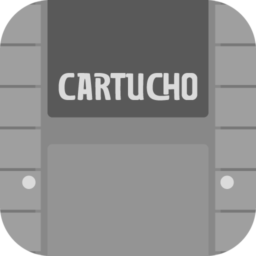

# Cartucho



**O Cartucho é um app que transforma o seu celular (Android) ou computador (Windows) num videogame antigo.**
Ele "finge" ser os consoles de antigamente, como Super Nintendo, Mega Drive, PlayStation e muitos outros, para você jogar os seus jogos onde estiver.

É **grátis para sempre**, não tem propaganda e funciona **sem internet**.

> O Cartucho não vem com jogos comerciais nem com BIOS (o "cérebro" de alguns consoles) e não diz onde conseguir. Use só arquivos que são seus. Na Loja do app há milhares de jogos grátis liberados pelos próprios autores.

---

## Como instalar

### No celular (Android)

1. Abra a página **[Releases](https://github.com/andrefeeelipe/Cartucho/releases/latest)** no navegador do celular.
2. Baixe o arquivo que termina em **`arm64-v8a.apk`**. Ele serve para quase todo celular de hoje.
3. Abra o arquivo baixado. O Android pergunta se pode instalar apps "desta fonte": diga que sim, instale e depois pode desligar essa permissão de novo.
4. Se aparecer um aviso do Play Protect, toque em **Instalar mesmo assim**. Isso acontece com qualquer app que não vem da Play Store.

Qual arquivo escolher:

| Arquivo | Para quem |
|---|---|
| `arm64-v8a` | Quase todos os celulares atuais |
| `armeabi-v7a` | Celulares bem antigos (sem os consoles mais pesados) |
| `x86_64` | Chromebooks e emuladores de Android no PC |
| `universal` | Funciona em qualquer um, mas é bem maior |

### No computador (Windows 10 ou 11)

1. Na mesma página **[Releases](https://github.com/andrefeeelipe/Cartucho/releases/latest)**, baixe o **`windows-instalador.exe`**. Se preferir usar sem instalar, baixe o **`windows-x64.zip`**.
2. Se o Windows mostrar um aviso azul (SmartScreen), clique em **Mais informações → Executar assim mesmo**. Ele avisa porque o app não tem um certificado pago.
3. Clique em **Adicionar pasta** e escolha onde estão seus jogos.

Teclas no PC: setas para andar · **Z** e **X** são os botões B e A · **Enter** é o Start · **Esc** abre o menu · **F2/F4** salva e carrega · **F11** tela cheia · **Tab** acelera. Qualquer controle USB ou Bluetooth funciona sem configurar, até 4 jogadores.

---

## O que dá para fazer

### 🎮 Biblioteca (a tela inicial)
- Escolha uma pasta e o Cartucho acha os jogos sozinho, inclusive dentro de arquivos `.zip`, `.7z` e `.rar`.
- **Nome e capa certos, sozinho:** o app olha *dentro* do arquivo (não no nome) e descobre qual jogo é. Ele funciona até se o arquivo se chamar "jogo1.bin". Depois troca para o nome oficial e baixa a capa certa. São mais de 80 mil jogos reconhecidos.
- Se não houver capa, ele cria uma bonita com o nome do jogo. Quer usar outra imagem? Segure o jogo → *Trocar capa*.
- Várias versões do mesmo jogo (Brasil, EUA, Japão, traduções) viram um cartão só. Ao tocar, você escolhe a versão.
- **Filtros:** por console, gênero, letra de A a Z, *Em português*, já jogados ou nunca jogados, e ordem.
- Tudo fica no botão **☰ (menu)** no canto de cima: Perfil, Baixar jogos, Jogar com amigos, Coleção, Buscar e Ajustes.

### ⬇️ Baixar jogos grátis (a Loja)
Mais de **9 mil jogos gratuitos** que os próprios criadores liberaram para todo mundo jogar:
- Game Boy, Game Boy Color, GBA e NES, do [Homebrew Hub](https://hh.gbdev.io)
- ZX Spectrum, só os que os autores ou as editoras liberaram ([ZXDB](https://github.com/zxdb/ZXDB) e [Spectrum Computing](https://spectrumcomputing.co.uk)). Inclui jogos brasileiros em português.
- TIC-80, um console "de mentirinha" feito para jogos novos, do [tic80.com](https://tic80.com)

Filtre por console, gênero (ação, aventura, plataforma, corrida…), letra, idioma, época, número de jogadores e ordem. Toque em **Baixar e jogar**: o jogo baixa direto do site do autor e entra na sua biblioteca. Nenhum jogo comercial é oferecido.

### 🙂 Perfil
- Sua foto da galeria, a foto do RetroAchievements ou um dos 12 bichinhos em pixel art do Cartucho.
- Seu **nível**, que sobe com pontos, horas jogadas e jogos zerados.
- Seus **troféus**: as conquistas do RetroAchievements, com a imagem de cada uma.
- Números da sua coleção: tempo jogado, zerados, platinas e quantidade de jogos.

### 🏆 Conquistas (RetroAchievements)
Entre com sua conta do [RetroAchievements](https://retroachievements.org) (é grátis). Enquanto você joga, aparecem troféus como "passou da fase 1 sem morrer", e cada um vale pontos. No **Mural** (em *Coleção*), você vê o que seus amigos estão jogando e zerando, e pode curtir, reagir com emoji e comentar.

### 👫 Jogar com amigos (até 4 jogadores)
No jogo, abra o menu → **Jogar com amigos**. Tem dois jeitos:

- **Aqui perto (todo mundo no mesmo lugar):** o celular cria um **Wi-Fi do Cartucho**. Os amigos leem o primeiro QR com a câmera para entrar na rede e o segundo QR para abrir o controle no navegador. Ninguém precisa instalar nada e não precisa de internet.
- **De longe (cada um na sua casa):** mande o convite pelo WhatsApp, pelo QR ou pelo código. Quem tem o Cartucho entra na sala, vê o jogo ao vivo e joga junto. Funciona até com todos nos dados móveis.

Controles Bluetooth ou USB ligados no celular também viram os jogadores 2, 3 e 4.

### 📺 Jogar na TV
No menu do jogo → **Transmitir para TV**. Funciona pelo espelhamento do Android (Smart View, Google Home) ou por cabo HDMI. São três modos: só no celular, no celular e na TV, ou só na TV, com o celular virando o controle. Até acelerado (2x, 3x, 4x) a imagem fica lisa.

### 📱 Telas do Nintendo DS e 3DS
No menu do jogo → **Telas** (só aparece no DS e no 3DS):
- **Automático:** com o celular deitado, as telas ficam lado a lado (a de cima à esquerda, a de baixo à direita). Em pé, uma em cima da outra.
- **Lado a lado**, **Uma em cima da outra** ou **Tela de cima grande**.

A tela de baixo continua de toque: é só tocar com o dedo.

### 🔒 Travar a tela
No menu do jogo → **Girar a tela**: escolha **girar junto com o celular**, **travar em pé** ou **travar deitado**. Travada, a tela não fica virando enquanto você mexe o celular, mesmo com o giro automático ligado.

### 🇧🇷 Traduções em português
Se o jogo tem tradução feita por fãs brasileiros, o app pergunta se você quer usar. O catálogo vem do [PO.B.R.E](https://romhackers.org/traducoes), com o nome de cada equipe. O arquivo original nunca é alterado.

### 🛠️ Hacks
Segure um jogo → **Hacks e traduções** para aplicar patches `.ips`, `.ups`, `.bps`, `.ppf` ou `xdelta`, por arquivo ou por link.

### 📒 Coleção e cartão para compartilhar
Marque jogos como jogando, zerado, platinado ou abandonado, dê de 0,5 a 5 estrelas e escreva o que achou. As horas são contadas sozinhas. Dá para gerar um **card** bonito do jogo e mandar no WhatsApp ou no Instagram.

### ☁️ Backup no Google Drive (opcional)
Em *Ajustes → Nuvem*, escolha sua conta. Os saves vão para a pasta *Cartucho* do seu Drive, e o app só enxerga essa pasta.

### 🎛️ Controles
Use os botões na tela, que você pode arrastar e mudar de tamanho, ou qualquer controle Bluetooth ou USB (Xbox, PlayStation, genéricos). Dá para trocar cada botão como preferir.

---

## Consoles

| Família | Consoles |
|---|---|
| Nintendo | NES · Super Nintendo · Game Boy · Game Boy Color · Game Boy Advance · Nintendo 64 · Nintendo DS · Nintendo 3DS · Virtual Boy · Pokémon Mini · Game & Watch · GameCube · Wii · Wii U (beta) |
| Sega | Master System · Game Gear · Mega Drive · Sega CD · 32X · Saturn · Dreamcast · VMU do Dreamcast · Naomi e Atomiswave (arcade) |
| Sony | PlayStation · PlayStation 2 · PSP |
| Microsoft | Xbox 360 (beta) · MSX |
| Atari | 2600 · 5200 · 7800 · 800/XL · Lynx · Jaguar · ST |
| SNK e NEC | Neo Geo (AES/MVS) · Neo Geo CD · Neo Geo Pocket · PC Engine / CD · PC-FX · PC-88 · PC-98 |
| Outros consoles | Arcade (FinalBurn Neo) · Philips CD-i (beta) · WonderSwan · 3DO · Vectrex · ColecoVision · Intellivision · Odyssey² · Channel F · Mega Duck · Arcadia 2001 · Super Cassette Vision · HyperScan (beta) · Uzebox · GameTank · Watara Supervision · Arduboy |
| De bolso | Celular Java / J2ME (beta) · Palm OS (beta) · Calculadora TI-83 |
| Computadores | ZX Spectrum · ZX81 · Amstrad CPC · Commodore 64, 128, VIC-20, Plus/4 e PET · Amiga · DOS · Apple II · Macintosh clássico · BBC Micro · Sharp X68000 e X1 · FM Towns (beta) · Enterprise 128 · Thomson MO/TO · Philips P2000 · Elektronika BK · Galaksija |
| Consoles "de mentirinha" | TIC-80 · PICO-8 · WASM-4 · LowRes NX |
| Jogos de PC clássicos | Doom · Quake · Wolfenstein 3D · Duke Nukem 3D · RPG Maker 2000/2003 · aventuras do ScummVM · OutRun (Cannonball) · **Cave Story (já vem grátis no app!)** |

**PlayStation 2 mais rápido:** se você colocar a BIOS do seu PS2 (em *Ajustes → BIOS*), o Cartucho usa um emulador bem mais rápido (ARMSX2 no celular, PCSX2 no PC). Sem BIOS, ele continua com o Play!, que não precisa dela. Dá para trocar no menu do jogo → *Emulador do PS2*.

**Jogos de PC em pasta** (Doom, Quake, Duke Nukem, RPG Maker, ScummVM): a forma mais fácil é colocar a pasta inteira do jogo num `.zip` e adicionar o `.zip`.

**No Windows, antes de abrir um jogo, o Cartucho avisa** se o seu computador vai rodar liso, pode engasgar, vai travar ou não roda. Depois que você joga, o aviso passa a usar a velocidade que ele mediu de verdade.

---

## Perguntas rápidas

**Precisa de internet?** Não para jogar. A internet só é usada para baixar capas e jogos da Loja, para as conquistas, para o backup e para jogar com amigos de longe.

**Por que não tem Nintendo Switch?** Em 2026 a Nintendo mandou tirar do ar 13 emuladores de Switch de uma vez. Se o Cartucho tivesse Switch, ele também seria derrubado, e todo o resto iria junto. Por isso ele fica de fora.

**Os jogos ficam lentos no meu celular. E agora?** Em *Ajustes → Sistemas neste aparelho*, o app diz com sinceridade o que roda bem no seu celular. Consoles pesados (PS2, GameCube, 3DS) precisam de celulares fortes.

**Meu jogo apareceu com o nome errado.** Espere alguns segundos com o app aberto: ele reconhece os jogos aos poucos. Se for um hack ou um jogo muito raro, talvez não esteja na lista. Aí dá para escolher a capa à mão.

---

## Limitações conhecidas

- PlayStation 2 ainda exige bastante do celular: nem todo jogo roda bem.
- Nintendo 3DS precisa de celular 64-bit forte, e os jogos precisam estar descriptografados (`.3ds`, `.cci`, `.cxi`, `.3dsx`).
- Ainda não abre arquivos `.rar` no formato RAR5.
- Jogos em vários arquivos (`.cue`/`.bin`, `.gdi`, `.m3u`) devem ser adicionados pela opção **Adicionar pasta**.
- O reconhecimento automático de nome ainda não lê `.cue`, `.chd` e `.cso`, e por enquanto só funciona no celular.

---

## Privacidade

- Sem propaganda, sem rastreamento e sem coleta de dados.
- Sua biblioteca, seus saves, sua foto de perfil e suas notas ficam **só no seu aparelho**.
- O app só pede o que precisa: internet, vibração, avisos do mural e acesso a "aparelhos por perto" para criar o Wi-Fi do Cartucho.
- Detalhes em [Privacidade](https://andrefeeelipe.github.io/Cartucho/privacidade.html) e [Termos](https://andrefeeelipe.github.io/Cartucho/termos.html).

---

## Para quem cuida do projeto

<details>
<summary>Como o Cartucho é montado (clique para abrir)</summary>

### O que tem neste repositório

| Arquivo | Para que serve |
|---|---|
| `cartucho-src.zip` | Todo o código do app (Android e Windows) |
| `.github/workflows/build.yml` | A "receita" que o GitHub segue para montar o app sozinho |
| `docs/` | O site do Cartucho (página inicial, privacidade, termos), a página dos convites da sala (`sala.html`) e o catálogo de traduções (`traducoes.json`) |
| `LICENSES.md` | As licenças dos emuladores e das outras peças usadas |

### Como uma versão nova nasce

A cada mudança enviada para a branch `main`, o **GitHub Actions** (grátis) faz tudo sozinho:

1. Baixa os emuladores oficiais do libretro, as listas para reconhecer jogos (libretro-database) e monta o catálogo da Loja.
2. Compila o app de Android e o de Windows.
3. **Testa de verdade:**
   - No Android: liga um celular de mentira e confere a sala online, o servidor de retransmissão, a Loja e os downloads.
   - No Windows: abre jogos grátis de seis consoles e confere se rodam.
4. Publica tudo em **Releases**, com o arquivo `SHA256SUMS` para conferir que nada foi alterado.

### Segredos do repositório

Ficam em *Settings → Secrets and variables → Actions* e nunca aparecem no código:

| Nome | O que é |
|---|---|
| `CARTUCHO_KEYSTORE_B64` | A chave que "assina" o app, em base64. Sem ela, as atualizações não instalam por cima da versão anterior. |
| `CARTUCHO_KEYSTORE_PASSWORD` | A senha dessa chave |
| `CARTUCHO_RELAY` | O servidor gratuito de retransmissão (TURN, do [ExpressTURN](https://expressturn.com)) que faz a sala "De longe" funcionar nos dados móveis |

Guarde o arquivo `cartucho.jks` num lugar seguro.

### Organização do código (dentro do zip)

```
app/src/main/cpp/          o "motor": roda os emuladores, a imagem, o som e as conquistas (C++)
app/src/main/java/...      as telas e as funções do app de Android (Kotlin + Jetpack Compose)
desktop/                   a versão para Windows (C++, SDL2, OpenGL, Dear ImGui)
scripts/fetch-deps.sh      baixa os emuladores e o que mais o app precisa
scripts/build-loja.py      monta o catálogo da Loja
scripts/build-ids.py       monta as listas que reconhecem os jogos
scripts/autoteste.sh       o teste automático do Android
```

### Login do Google Drive para quem compila a própria versão

É preciso criar um "ID do cliente OAuth" do tipo **Android** no Google Cloud, com o pacote `app.cartucho` e o SHA-1 da sua chave, e ativar a **Google Drive API** no mesmo projeto.

</details>

---

Licenças: veja [LICENSES.md](LICENSES.md). Contato: andre.rpgxp@gmail.com
