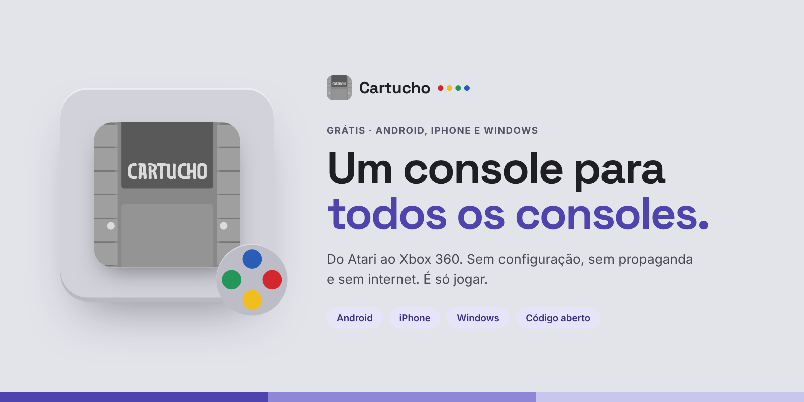
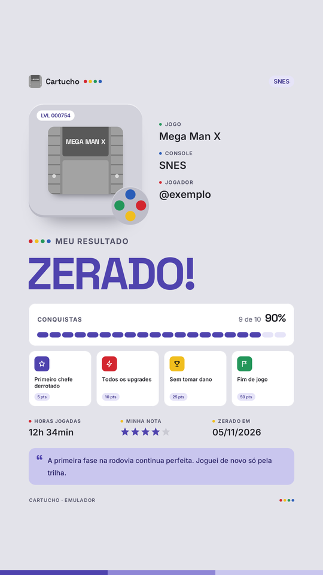
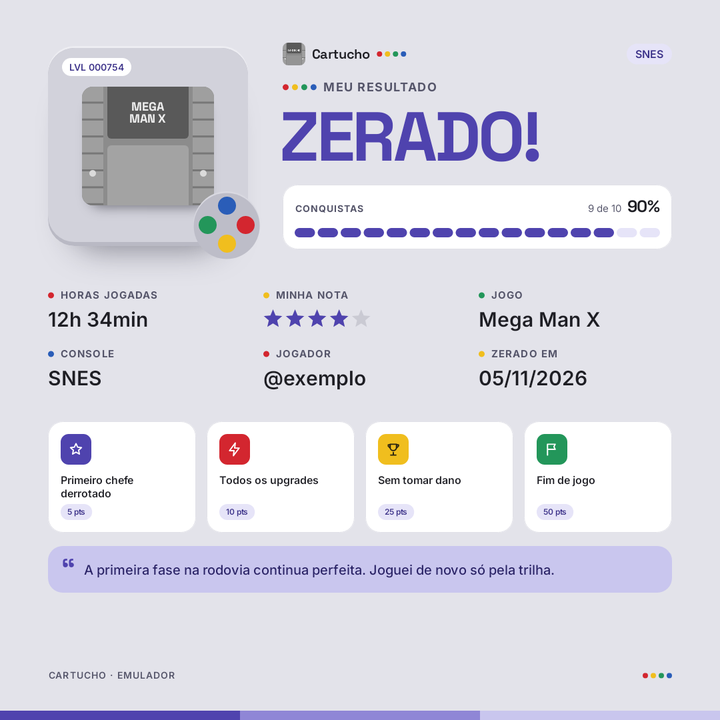
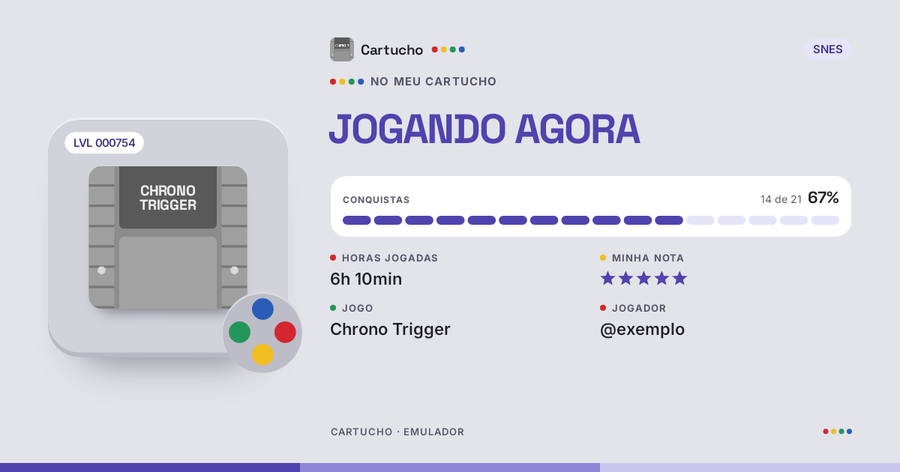

# Cartucho



### Baixe aqui: **[cartucho-emulador.netlify.app](https://cartucho-emulador.netlify.app)**

**O Cartucho transforma o seu celular ou o seu computador num videogame antigo.**

Sabe aqueles videogames de antigamente, como o Super Nintendo, o Mega Drive e o PlayStation? O Cartucho "finge" ser eles. Assim você joga os seus jogos no celular (Android ou iPhone) ou no computador (Windows), onde estiver.

- **É de graça.** Para sempre.
- **Não tem propaganda.**
- **Funciona sem internet.**

> **Importante:** o Cartucho não vem com jogos de loja nem com a BIOS (BIOS é o "cérebro" de alguns videogames). Ele também não diz onde achar. Use só arquivos que são seus. Mas dentro do app tem uma Loja com milhares de jogos grátis, que os próprios criadores liberaram.

---

## Como instalar

O jeito mais fácil é pelo site: **[cartucho-emulador.netlify.app](https://cartucho-emulador.netlify.app)**. Ele sempre mostra a versão mais nova e já sabe se você está no celular ou no computador.

### No celular (Android)

1. Abra o **[site do Cartucho](https://cartucho-emulador.netlify.app)** no navegador do celular.
2. Toque em **Baixar para Android**.
3. Abra o arquivo que baixou.
4. O celular vai perguntar se pode instalar apps "desta fonte". Toque em **sim**. Depois de instalar, você pode desligar isso de novo.
5. Se aparecer um aviso do **Play Protect**, toque em **Instalar mesmo assim**. Esse aviso aparece com qualquer app que não veio da Play Store.

Tem mais de um arquivo de Android. Qual é o seu?

| Arquivo | Para quem |
|---|---|
| `arm64-v8a` | Quase todos os celulares de hoje. **Na dúvida, é este.** |
| `armeabi-v7a` | Celulares bem velhinhos (os videogames mais pesados não rodam) |
| `x86_64` | Chromebooks e "celulares de mentira" no computador |
| `universal` | Funciona em qualquer um, mas é bem maior |

### No iPhone e no iPad (iOS 14 ou mais novo)

A Apple só deixa instalar apps de fora da App Store por um "instalador" como o **AltStore** ou o **SideStore**. Os dois são grátis e usam o seu próprio ID Apple.

1. Instale o **[AltStore](https://altstore.io)** ou o **[SideStore](https://sidestore.io)** seguindo o passo a passo do site deles (o AltStore precisa de um computador na primeira vez).
2. No iPhone, abra o **[site do Cartucho](https://cartucho-emulador.netlify.app)** e toque em **Baixar para iPhone (.ipa)**.
3. Abra o AltStore ou SideStore, vá em **My Apps**, toque em **+** e escolha o arquivo do Cartucho.
4. Com ID Apple grátis, o app precisa ser renovado a cada 7 dias: abra o AltStore ou SideStore e toque em **Refresh**. Seus jogos e saves continuam lá.

Para colocar os seus jogos: app **Arquivos → No meu iPhone → Cartucho**. No iPhone o Cartucho roda do Atari ao **PlayStation, PSP, Nintendo 64 e Nintendo DS**, com controle na tela. Os mais pesados (PS2, GameCube, 3DS, Dreamcast, Saturn) ficam de fora: o iPhone não deixa os emuladores usarem a técnica que dá velocidade a eles.

### No computador (Windows 10 ou 11)

1. Abra o **[site do Cartucho](https://cartucho-emulador.netlify.app)** e clique em **Baixar para Windows**.
2. Abra o arquivo. Se aparecer uma tela azul dizendo "O Windows protegeu o computador", clique em **Mais informações** e depois em **Executar assim mesmo**. Ela aparece porque o Cartucho não pagou por um "selo" da Microsoft. Não tem problema.
3. Abra o **Cartucho** pelo atalho na área de trabalho.
4. Clique em **Adicionar pasta** e escolha onde estão os seus jogos.

Quer usar sem instalar? Baixe o `windows-x64.zip`, abra a pasta e clique em `Cartucho.exe`.

**Saiu versão nova?** É só instalar por cima. Seus jogos, saves e ajustes continuam lá.

**Computador fraquinho ou sem placa de vídeo boa?** O Cartucho percebe sozinho e usa o processador para mostrar a imagem. Os jogos leves rodam bem. Os pesados (PS2, GameCube) ficam lentos. Instalar o programa da placa de vídeo (o "driver") ajuda.

### Teclas no computador

| Tecla | O que faz |
|---|---|
| Setas | Andar |
| **Z** e **X** | Botões B e A |
| **Enter** | Start |
| **Esc** | Abre o menu |
| **F2** / **F4** | Salvar / carregar o jogo |
| **F11** | Tela cheia |
| **Tab** | Acelerar o jogo |

Qualquer controle USB ou Bluetooth funciona sozinho, sem configurar. Dá para jogar até 4 pessoas.

---

## O que dá para fazer

### O jeito do app

Embaixo da tela ficam quatro abas: **Biblioteca**, **Loja**, **Online** e **Ajustes**. No computador, elas ficam num menu do lado esquerdo.

### Biblioteca (a primeira tela)
- Você escolhe uma pasta e o Cartucho acha os jogos sozinho. Até os que estão dentro de arquivos compactados (`.zip`, `.7z`, `.rar`).
- **Ele descobre o nome e a capa sozinho.** Mesmo que o arquivo se chame "jogo1", ele olha dentro e descobre qual jogo é. Ele conhece mais de 80 mil jogos!
- **Nada repetido.** Se você tiver o mesmo jogo duas vezes (ou em versões diferentes, como Brasil, EUA e Japão), aparece um cartão só. Quando você toca, escolhe a versão.
- Jogo sem capa? Ele faz uma bonita com o nome. Quer outra imagem? Segure o dedo no jogo e toque em *Trocar capa*.
- **Jogo cortado em pedaços?** Alguns jogos grandes vêm em várias partes (`.001`, `.002`…). O Cartucho junta tudo sozinho. É só deixar as partes na mesma pasta.
- **Um arquivo com muitos jogos dentro?** Na primeira vez que você tocar nele, cada jogo vira um cartão separado.
- **Filtros:** por videogame, por tipo de jogo, de A a Z, só os *Em português*, os que você já jogou e os que nunca jogou.
- **Continuar jogando:** o último jogo aparece no topo, com um botão roxo para voltar a jogar na hora.
- **Toque numa capa** para abrir a página do jogo: horas jogadas, saves, sua nota, troféus e os botões **Jogar** e **Compartilhar**.
- No canto de cima ficam o **+** (para abrir um jogo ou uma pasta) e a sua foto (Perfil e Coleção).

### Loja de jogos grátis
Mais de **9 mil jogos de graça**, que os próprios criadores deixaram todo mundo jogar:
- Game Boy, Game Boy Color, Game Boy Advance e NES, do [Homebrew Hub](https://hh.gbdev.io)
- ZX Spectrum, só os liberados pelos autores ([ZXDB](https://github.com/zxdb/ZXDB) e [Spectrum Computing](https://spectrumcomputing.co.uk)). Tem até jogos brasileiros em português!
- TIC-80, um videogame "de mentirinha" feito para jogos novos, do [tic80.com](https://tic80.com)

Escolha um jogo e toque em **Baixar e jogar**. Ele baixa direto do site de quem criou e já aparece na sua biblioteca. A Loja não tem jogos de loja de verdade, só os liberados.

### Perfil
- Coloque uma foto sua ou escolha um dos 12 bichinhos desenhados em pixel.
- Veja o seu **nível**. Ele sobe quando você joga, ganha pontos e termina jogos.
- Veja os seus **troféus** e quanto tempo você já jogou.

### Troféus (RetroAchievements)
Crie uma conta grátis no [RetroAchievements](https://retroachievements.org) e entre com ela no app. Enquanto você joga, aparecem troféus como "passou da fase 1 sem morrer". Cada troféu vale pontos. No **Mural** (em *Coleção*), você vê o que seus amigos estão jogando e pode curtir e comentar.

**Jogando a versão traduzida?** Quando o RetroAchievements não conhece a tradução, o Cartucho procura o jogo pelo nome e usa os troféus da versão oficial. No modo *hardcore* isso não vale: lá só contam as versões que o RetroAchievements aceita.

### Jogar com amigos (até 4 pessoas)
Na aba **Online**, escolha um jogo e toque em **Criar sala**, ou digite o código de 6 letras de um amigo para entrar na sala dele. Dentro do jogo, o menu também tem **Jogar com amigos**. Tem dois jeitos:

- **Aqui perto (todo mundo no mesmo lugar):** o celular cria um Wi-Fi do Cartucho. Os amigos apontam a câmera para o primeiro QR (para entrar no Wi-Fi) e para o segundo QR (para virar controle). Eles não precisam instalar nada e não precisa de internet.
- **De longe (cada um na sua casa):** mande o convite pelo WhatsApp, pelo QR ou pelo código. Quem tem o Cartucho entra na sala e joga junto. Funciona até usando os dados do celular.

Controles ligados no celular também viram os jogadores 2, 3 e 4.

### Jogar na TV
No menu do jogo, toque em **Transmitir para TV**. Funciona espelhando a tela do celular (Smart View, Google Home) ou com cabo HDMI. Você pode ver só no celular, nos dois, ou só na TV (aí o celular vira o controle).

### Duas telas (Nintendo DS e 3DS)
No menu do jogo, toque em **Telas** para escolher como as duas telas aparecem: lado a lado, uma em cima da outra, ou a de cima grande. A tela de baixo funciona com o dedo, igual ao videogame de verdade.

### Travar a tela
No menu do jogo, toque em **Girar a tela**. Você pode deixar a tela girar junto com o celular, ou travar em pé, ou travar deitada.

### Save automático
O Cartucho guarda o seu progresso sozinho, em 3 pontos que vão se revezando. Você escolhe de quanto em quanto tempo: de 1 a 30 minutos (o normal é 5). Se o jogo travar, ele avisa e você volta do último ponto. No menu do jogo, toque em *Mais opções → Save automático*.

### Jogos traduzidos
Se fãs brasileiros traduziram o jogo para o português, o app pergunta se você quer usar a tradução. As traduções vêm do [PO.B.R.E](https://romhackers.org/traducoes), com o nome de quem traduziu. O seu arquivo original não muda.

### Hacks
Hack é uma versão modificada de um jogo (com fases novas, por exemplo). Segure o dedo num jogo e toque em **Hacks e traduções** para colocar uma.

### Coleção
Marque cada jogo como *jogando*, *zerado*, *platinado* ou *larguei*. Dê estrelas e escreva o que achou. O app conta as horas sozinho.

### Compartilhar o seu jogo
Na página do jogo (ou no menu de pausa), toque em **Compartilhar**. O Cartucho monta um card com o jogo, o seu resultado (**ZERADO!** ou **JOGANDO AGORA**), os troféus, as horas, a sua nota e um comentário seu. Tem três tamanhos:

| Story (celular) | Feed (tablet) | Link (computador) |
|---|---|---|
|  |  |  |

O card sempre leva a **capa do jogo**. Toque em **Compartilhar** para mandar no WhatsApp ou no Instagram, ou em **Salvar imagem**. No computador, clique com o botão direito numa capa e escolha *Compartilhar card*: a imagem fica salva e já copiada, é só colar. No iPhone, segure a capa e escolha *Compartilhar card*.

### Guardar o progresso no Google Drive (se quiser)
Em *Ajustes → Nuvem*, escolha sua conta do Google. Seus saves vão para uma pasta chamada *Cartucho* no seu Drive. Assim você pode começar no celular e continuar no computador. O app só mexe nessa pasta.

### Controles
Use os botões na tela (no Android dá para arrastar e mudar o tamanho) ou um controle de verdade, com fio ou Bluetooth. Dá para trocar a função de cada botão no Android. **Select + Start juntos** abrem o menu do jogo em qualquer controle.

| Controle | Android | iPhone | Windows |
|---|---|---|---|
| PlayStation 4 e 5 (Bluetooth) | Sim | Sim | Sim |
| Xbox One S, Series (Bluetooth) | Sim | Sim | Sim |
| Xbox One de 2013 (sem Bluetooth) | Com cabo USB | Não | Com cabo USB |
| Xbox 360 (não tem Bluetooth) | Com fio, por adaptador USB-C | Não | Com fio, ou sem fio com o receptor da Microsoft |
| 8BitDo, GameSir, Switch Pro | Sim | Sim | Sim |
| Genéricos Bluetooth | Sim | Só com modo iOS ou selo MFi | Sim |

O Windows e o iPhone trazem a lista da comunidade com os botões de milhares de controles. Controle que não está na lista também funciona, com o layout mais comum dos genéricos.

---

## Videogames que funcionam

| Família | Videogames |
|---|---|
| Nintendo | NES · Super Nintendo · Game Boy · Game Boy Color · Game Boy Advance · Nintendo 64 · Nintendo DS · Nintendo 3DS · Virtual Boy · Pokémon Mini · Game & Watch · GameCube · Wii · Wii U (beta) |
| Sega | Master System · Game Gear · Mega Drive · Sega CD · 32X · Saturn · Dreamcast · VMU do Dreamcast · Naomi e Atomiswave (arcade) |
| Sony | PlayStation · PlayStation 2 · PSP |
| Microsoft | Xbox 360 (beta) · MSX |
| Atari | 2600 · 5200 · 7800 · 800/XL · Lynx · Jaguar · ST |
| SNK e NEC | Neo Geo (AES/MVS) · Neo Geo CD · Neo Geo Pocket · PC Engine / CD · PC-FX · PC-88 · PC-98 |
| Outros | Arcade (FinalBurn Neo) · Philips CD-i (beta) · WonderSwan · 3DO · Vectrex · ColecoVision · Intellivision · Odyssey² · Channel F · Mega Duck · Arcadia 2001 · Super Cassette Vision · HyperScan (beta) · Uzebox · GameTank · Watara Supervision · Arduboy |
| De bolso | Celular Java / J2ME (beta) · Palm OS (beta) · Calculadora TI-83 |
| Computadores antigos | ZX Spectrum · ZX81 · Amstrad CPC · Commodore 64, 128, VIC-20, Plus/4 e PET · Amiga · DOS · Apple II · Macintosh clássico · BBC Micro · Sharp X68000 e X1 · FM Towns (beta) · Enterprise 128 · Thomson MO/TO · Philips P2000 · Elektronika BK · Galaksija |
| Videogames "de mentirinha" | TIC-80 · PICO-8 · WASM-4 · LowRes NX |
| Jogos clássicos de computador | Doom · Quake · Wolfenstein 3D · Duke Nukem 3D · RPG Maker 2000/2003 · aventuras do ScummVM · OutRun (Cannonball) · **Cave Story (já vem grátis no app!)** |

*"Beta" quer dizer que ainda está em teste: pode ter erros.*

**PlayStation 2: coloque a BIOS para os jogos não fecharem.**
Com a BIOS do seu PS2 (em *Ajustes → BIOS → PlayStation 2*), o Cartucho usa um "motor" mais forte, e os jogos rodam melhor e não fecham sozinhos. Sem a BIOS, ele usa outro motor, mas alguns jogos fecham no meio. Se fechar, não se preocupe: o save automático guarda o seu progresso, e a biblioteca mostra **Continuar de onde parou**.

> **De onde vem a BIOS?** Do seu próprio PlayStation 2. Ela pertence à Sony, por isso o Cartucho não traz e não diz onde baixar. Para copiar a do seu videogame, use o programa grátis *biosdrain* no seu PS2. Ele grava o arquivo num pendrive.

**Jogos de computador (Doom, Quake e outros):** coloque a pasta inteira do jogo dentro de um `.zip` e adicione o `.zip` no Cartucho.

**No iPhone** entram os videogames até o PlayStation e o PSP (incluindo Nintendo 64 e Nintendo DS), além dos computadores antigos e dos jogos clássicos de computador.

**No computador, o Cartucho avisa antes de abrir o jogo** se ele vai rodar liso, engasgar, travar ou nem abrir. Depois que você joga, o aviso fica ainda mais certo.

---

## Perguntas rápidas

**Precisa de internet?**
Para jogar, não. A internet só é usada para baixar capas, baixar jogos da Loja, ganhar troféus, guardar no Drive e jogar com amigos de longe.

**Por que não tem Nintendo Switch?**
Em 2026, a Nintendo mandou tirar do ar vários programas que rodavam jogos de Switch. Se o Cartucho tivesse Switch, ele poderia ser tirado do ar também, e todo mundo perderia o resto. Por isso o Switch fica de fora.

**Por que o iPhone precisa do AltStore ou SideStore?**
Para entrar na App Store, a Apple cobra uma taxa por ano de quem publica. O Cartucho é 100% grátis, então ele é instalado pelo AltStore ou SideStore, que são grátis e usam o seu próprio ID Apple.

**Os jogos estão lentos no meu celular. E agora?**
Vá em *Ajustes → Sistemas neste aparelho*. O app conta, com sinceridade, o que roda bem no seu celular. Os videogames mais pesados (PS2, GameCube, 3DS) precisam de celulares fortes.

**Meu jogo apareceu com o nome errado.**
Espere alguns segundos com o app aberto: ele reconhece os jogos aos poucos. Se for um jogo muito raro, escolha a capa você mesmo.

---

## O que ainda não funciona direito

- **PlayStation 2** pesa bastante no celular. Nem todo jogo roda bem.
- **Nintendo 3DS** precisa de um celular forte, e o jogo precisa estar "aberto" (descriptografado), nos formatos `.3ds`, `.cci`, `.cxi` ou `.3dsx`.
- **iPhone (primeira versão):** sem saves no Google Drive, sem salas online e sem conquistas por enquanto. PSP e Nintendo 64 podem engasgar, porque o iPhone não deixa os emuladores usarem JIT.
- Arquivos `.rar` do tipo RAR5 ainda não abrem.
- Jogos feitos de vários arquivos (`.cue`/`.bin`, `.gdi`, `.m3u`) precisam ser adicionados pelo botão **Adicionar pasta**.
- O reconhecimento de nome ainda não lê `.cue`, `.chd` e `.cso`, e por enquanto só funciona no celular.

---

## A cara do Cartucho

O visual lembra os videogames cinza dos anos 90: plástico claro, listras roxas e quatro botões coloridos. Só a cor e a forma, sem usar a marca de ninguém.

| | |
|---|---|
| **Cores** | Cinza console `#E3E3EA`, roxo `#4F43AE` e os quatro pontos: vermelho `#D3262F`, amarelo `#F0BE1E`, verde `#23965A` e azul `#2A5DB8` |
| **Letras** | [Space Grotesk](https://github.com/floriankarsten/space-grotesk) nos títulos e [Inter](https://rsms.me/inter/) no resto (as duas são grátis, licença OFL) |
| **Jeito** | Uma ideia por tela, cantos arredondados e frases curtas |

---

## Seus dados

- Sem propaganda. Ninguém fica espiando o que você faz.
- Seus jogos, saves, foto e anotações ficam **só no seu aparelho**.
- O app só pede o que precisa: internet, vibrar, avisos do mural e "aparelhos por perto" (para criar o Wi-Fi do Cartucho).
- Os detalhes estão em [Privacidade](https://andrefeeelipe.github.io/Cartucho/privacidade.html) e [Termos](https://andrefeeelipe.github.io/Cartucho/termos.html).

---

## Para quem cuida do projeto

<details>
<summary>Como o Cartucho é montado (clique para abrir)</summary>

### O que tem aqui dentro

| Arquivo ou pasta | Para que serve |
|---|---|
| `cartucho-src.zip` | Todo o código do app (celular e computador), guardado num arquivo só |
| `.github/workflows/build.yml` | A "receita": o passo a passo que o GitHub segue para montar o app sozinho |
| `site/` | O site de download ([cartucho-emulador.netlify.app](https://cartucho-emulador.netlify.app)) |
| `netlify.toml` | Diz ao Netlify (quem deixa o site no ar, de graça) onde está o site |
| `docs/` | As páginas de Privacidade e Termos, a página de convite para jogar junto (`sala.html`) e a lista de traduções (`traducoes.json`) |
| `LICENSES.md` | As licenças: quem fez cada peça que o Cartucho usa |

### Como uma versão nova nasce

Toda vez que alguém manda uma mudança para a branch `main`, o **GitHub Actions** (um robô grátis do GitHub) faz tudo sozinho:

1. **Junta as peças:** baixa os emuladores, a lista que reconhece os jogos e o catálogo da Loja.
2. **Monta o app:** um para Android, um para Windows e um para iPhone (o `.ipa`, num Mac do GitHub).
3. **Testa de verdade:**
   - no Android, liga um celular de mentira e testa a sala de jogar junto, a Loja e os downloads;
   - no Windows, abre jogos grátis de vários videogames para ver se rodam.
4. **Publica** tudo em **Releases**, junto com o arquivo `SHA256SUMS`. Ele é como uma "impressão digital" de cada arquivo, para conferir que ninguém mexeu nele.
5. **O site se atualiza sozinho:** os botões de download sempre pegam a versão mais nova das Releases.

Mudanças só na pasta `site/` **não** montam o app de novo. Elas só atualizam o site.

### Segredos do repositório

São senhas que ficam escondidas em *Settings → Secrets and variables → Actions*. Elas nunca aparecem no código.

| Nome | O que é |
|---|---|
| `CARTUCHO_KEYSTORE_B64` | A "assinatura" do app. Sem ela, as versões novas não instalam por cima das antigas. |
| `CARTUCHO_KEYSTORE_PASSWORD` | A senha dessa assinatura |
| `CARTUCHO_RELAY` | O servidor grátis ([ExpressTURN](https://expressturn.com)) que faz o "jogar de longe" funcionar nos dados do celular |
| `NETLIFY_BUILD_HOOK` | (opcional) Avisa o Netlify quando sai versão nova |

Guarde o arquivo `cartucho.jks` (a assinatura) num lugar seguro. Se perder, as pessoas vão precisar desinstalar e instalar de novo.

### Onde fica cada parte do código (dentro do zip)

```
app/src/main/cpp/          o "motor": roda os emuladores, a imagem, o som e os troféus (C++)
app/src/main/java/...      as telas do app de Android (Kotlin + Jetpack Compose)
desktop/                   as versões para Windows e iPhone (C++, SDL2, OpenGL / OpenGL ES, Dear ImGui)
desktop/src/touch.h        no iPhone: toque na interface e o controle na tela
desktop/ios/Info.plist     no iPhone: nome, ícone, pastas no app Arquivos
scripts/fetch-deps.sh      baixa os emuladores e o resto que o app precisa
scripts/build-loja.py      monta o catálogo da Loja
scripts/build-ids.py       monta as listas que reconhecem os jogos
scripts/autoteste.sh       o teste automático do Android
```

### Login do Google Drive para quem monta a própria versão

Crie um "ID do cliente OAuth" do tipo **Android** no Google Cloud, com o pacote `app.cartucho` e o SHA-1 da sua assinatura. Depois ative a **Google Drive API** no mesmo projeto.

</details>

---

© 2026 André Felipe. O nome **Cartucho**, o logo e o site são dele: veja [MARCA.md](MARCA.md).
O código do app usa a licença GPLv3; as licenças de cada peça estão em [LICENSES.md](LICENSES.md). Contato: andre.rpgxp@gmail.com
